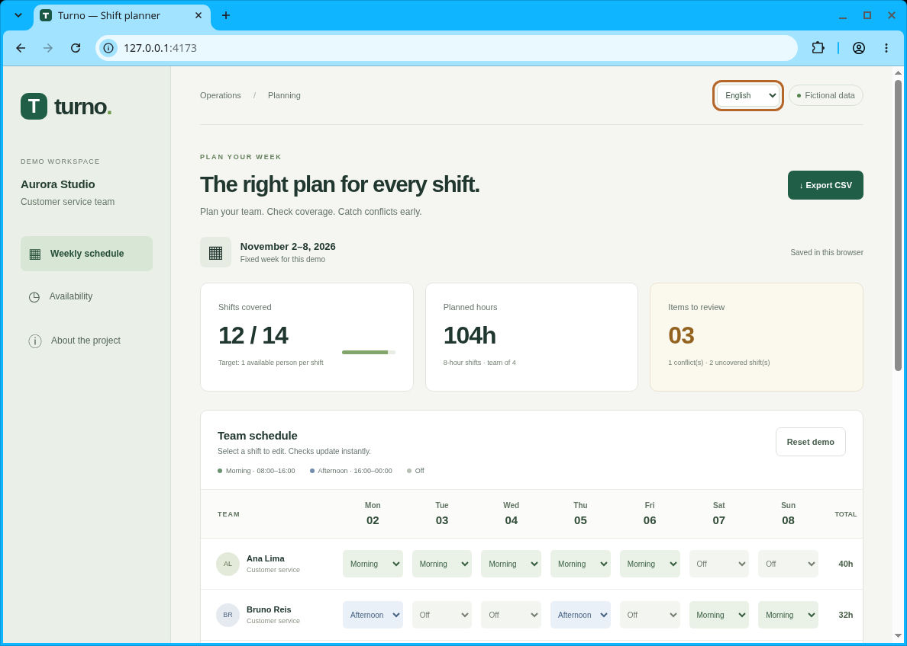

# Turno · Weekly shift planner

**Português · English · 日本語** — demonstração de produto para portfólio, sem dependências de execução.

Turno transforma uma escala semanal em um exercício de modelagem de regras, feedback de interface e acessibilidade. O cenário é um pequeno ateliê fictício com quatro pessoas e dois turnos por dia. Não é um projeto de cliente e não usa dados de empresas ou pessoas reais.

## Experimentar

```sh
# Node.js 20 ou superior; não é necessário npm install
npm start
# Abra http://127.0.0.1:4173
npm test
npm run check
```

Sirva por HTTP: abrir `index.html` diretamente com `file://` pode bloquear os módulos JavaScript. `server.js` é apenas um servidor de desenvolvimento local, não uma solução de produção. Para preparar hospedagem estática, execute `npm run build`; a pasta `dist/` conterá somente `index.html`, `style.css` e `src/`. O build é opcional para execução local.

## O que demonstra

- Edição de um turno por pessoa por dia, com regras de disponibilidade e limite demonstrativo de 40 horas semanais.
- Cobertura independente para manhã e tarde: uma atribuição indisponível não conta para a meta.
- Resumo derivado do estado, avisos textuais e cores complementares; nenhuma decisão automatizada sobre contratação ou aptidão.
- Português, inglês e japonês, incluindo validações, labels acessíveis, horas e CSV. A escolha do idioma fica no navegador.
- Persistência local versionada e validada; dados corrompidos voltam ao exemplo, armazenamento bloqueado gera aviso.
- Restauração com confirmação/cancelamento e exportação CSV com BOM UTF-8, aspas e proteção contra fórmulas.
- Layout responsivo, navegação por teclado, foco visível, tabela semântica com rolagem horizontal no celular e anúncios de atualização.

### Roteiro de demonstração

1. O exemplo começa com **12/14** turnos cobertos: Clara está indisponível na terça à tarde e domingo à tarde está vazio.
2. Mude Clara na terça para **Folga**, Bruno na terça para **Tarde** e Davi no domingo para **Tarde**.
3. Veja **14/14**, sem conflitos. Recarregue para conferir a persistência.
4. Experimente atribuir Ana no sábado: surgem conflito de disponibilidade e alerta de 48h.
5. Troque o idioma, exporte CSV e use **Restaurar demo** para recomeçar.

## Arquitetura

```text
index.html           Estrutura semântica e conteúdo inicial em português
style.css            Design responsivo sem bibliotecas ou fontes externas
src/domain.js        Regras puras, validação do estado, restauração e CSV
src/i18n.js          Catálogo PT/EN/JA e formatação de mensagens
src/app.js           DOM, eventos, estado local e persistência
server.js            Servidor HTTP local sem dependências
 tests/*.test.js     Testes com node:test
```

O estado guarda somente identificadores e turnos. Métricas e conflitos são recalculados; não há totais duplicados em armazenamento. `assign()` devolve um novo estado e rejeita pessoas, dias e turnos desconhecidos. Os dados persistidos são validados e reconstruídos com propriedades permitidas antes de uso. Conteúdo dinâmico é criado com `textContent`, não HTML interpolado.

## Testes e verificação

`npm test` cobre cenário inicial, edição imutável, entradas inválidas, resolução de conflitos, carga horária, cobertura excluindo indisponibilidade, persistência corrompida, escaping CSV e completude do catálogo em três idiomas. Testes de eventos de interface usam um adaptador DOM leve para verificar edição, cancelamento/restauração, idiomas e falhas de armazenamento; não simulam renderização real. Consulte `docs/QA.md` para os resultados de verificação de interface e os limites observados.

## Limites deliberados

- Uma única semana fixa (2–8 novembro de 2026), equipe e disponibilidade fixas. Não há cadastro, backend, login, sincronização ou colaboração multiusuário.
- Duas opções de turno de 8h; um único turno por pessoa/dia. Não trata intervalos, descanso entre jornadas, fuso horário, feriados, banco de horas, adicional noturno ou legislação trabalhista.
- O turno 16–00h é atribuído ao dia em que começa. O limite de 40h é uma regra do exemplo, **não uma conclusão legal**.
- CSV exporta a escala atual mesmo com conflitos; o sistema orienta, mas não bloqueia a simulação.
- Dados ficam em `localStorage`, sem criptografia. Não use dados pessoais reais ou sensíveis. Limpar dados do navegador remove as edições.
- Nenhum recurso externo, analytics ou rastreamento. Nenhum resultado operacional real ou cliente é alegado.

## English

Turno is a portfolio demo of a weekly shift planner using fictional people and a fictional business. It demonstrates immutable domain logic, availability validation, staffing coverage, local persistence, accessible UI and safe CSV export. Switch between Portuguese, English and Japanese in the header. Run `npm start` with Node.js 20+, then visit localhost:4173; run `npm test` for the automated tests. No install or backend is required. The fixed 40-hour rule is a demo constraint, not legal advice or labor-law validation.

## 日本語

Turnoはポートフォリオ用の週間シフト管理デモです。登場する人物・店舗・予定はすべて架空です。勤務可能時間の確認、必要人数の計算、ローカル保存、アクセシブルな画面、CSV出力を実装しています。ヘッダーでポルトガル語・英語・日本語を切り替えられます。Node.js 20以上で `npm start` を実行し、localhost:4173 を開いてください。テストは `npm test` で実行できます。インストールやバックエンドは不要です。週40時間という条件はデモ用であり、労働法への適合性を判断するものではありません。

## Captura de tela / Screenshot / 画面


